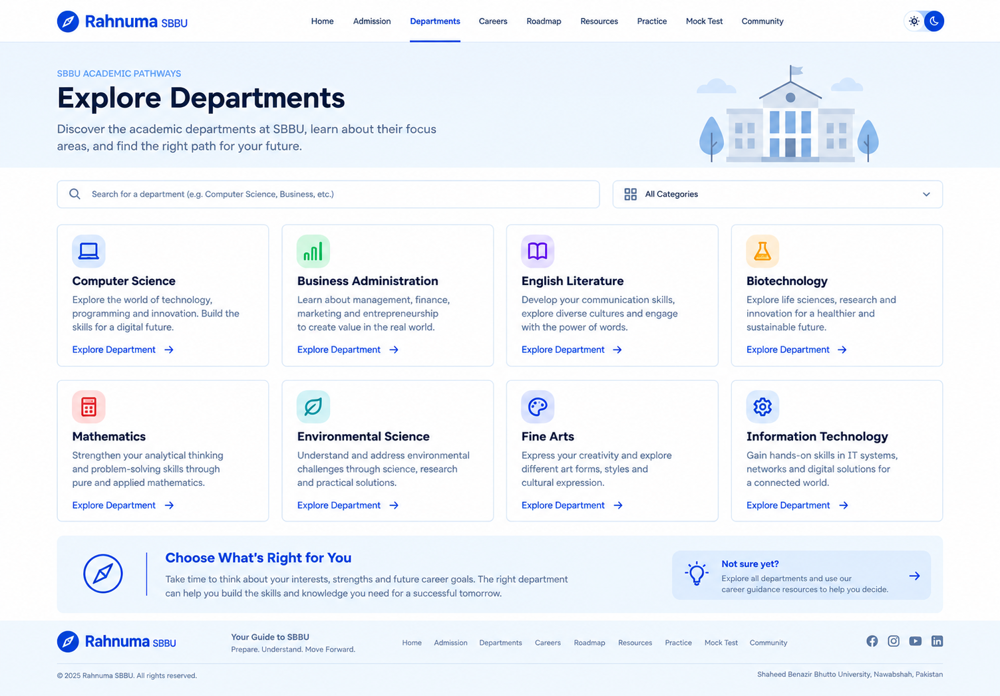
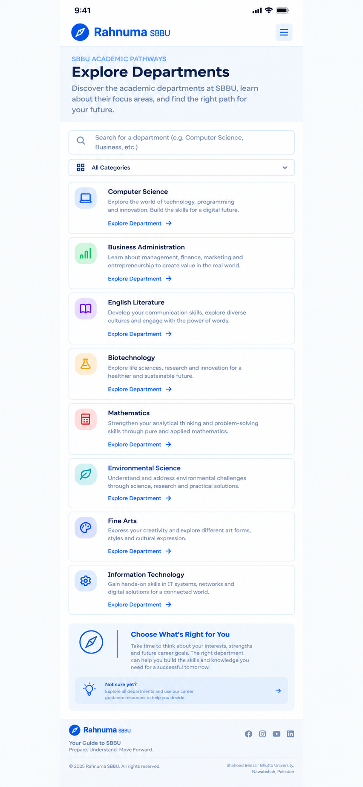

# Departments Page Wireframe

## Overview

The Departments page helps students explore academic departments at Shaheed Benazir Bhutto University (SBBU), Nawabshah, and understand their areas of study so they can make informed academic and career decisions.

This wireframe defines the desktop and mobile layouts before implementation.

## Wireframes

### Desktop



### Mobile



## Page Structure

The Departments page contains the following sections:

1. **Navigation Bar** — Rahnuma branding, main navigation links, active Departments state, and theme controls on desktop.
2. **Hero Section** — Page heading, short introduction, and a university illustration on desktop.
3. **Search and Category Filter** — Helps students find departments by name and browse available categories.
4. **Department Cards** — Displays department names, icons, short descriptions, and “Explore Department” links.
5. **Career Guidance Section** — Encourages students to consider their interests, strengths, and future career goals.
6. **Footer** — Rahnuma branding, navigation links, social icons, and university information.

## Responsive Behavior

### Desktop
- Displays department cards in a four-column grid.
- Places the search field and category filter side by side.
- Uses a full navigation bar and a two-part career guidance section.

### Mobile
- Replaces desktop navigation with a compact header and menu button.
- Stacks the search field and category filter vertically.
- Displays department cards in a single-column layout.
- Stacks the career guidance content and callout.
- Uses a compact footer with wrapped content.

## Design Guidelines

- **Style:** Clean, modern, student-friendly, and trustworthy.
- **Headings:** Lexend.
- **Body and UI:** Inter.
- **Primary color:** `#1D4ED8`
- **Accent color:** `#F59E0B`
- **Background:** `#F8FAFC`
- **Surface:** `#FFFFFF`
- **Text:** `#0F172A`
- **Muted text:** `#475569`
- **Border:** `#D5DCE6`

The page follows the existing Rahnuma design system and prioritizes readability, consistent spacing, clear navigation, and responsive layouts.

## Content Accuracy

Department names and descriptions shown in the wireframes are illustrative placeholders. They must be checked against official SBBU sources before being published as actual university offerings.

Department links should connect to appropriate department information when those destinations are implemented.

## Scope

This document covers the visual wireframes only. HTML, CSS, JavaScript, functional search and filtering, and department detail pages are part of implementation work, not the wireframing stage.

## Status

- [x] Desktop wireframe designed
- [x] Mobile wireframe designed
- [x] Responsive layout planned
- [x] README prepared
- [ ] Files committed and pushed to GitHub
- [ ] GitHub issue closed

## Files

```text
wireframes/departments-page/
├── desktop.png
├── mobile.png
└── README.md
```